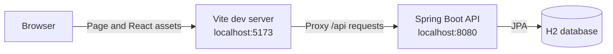
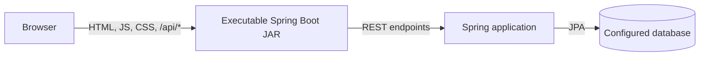
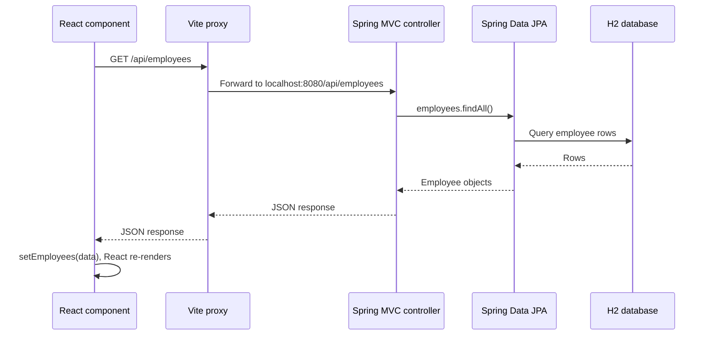
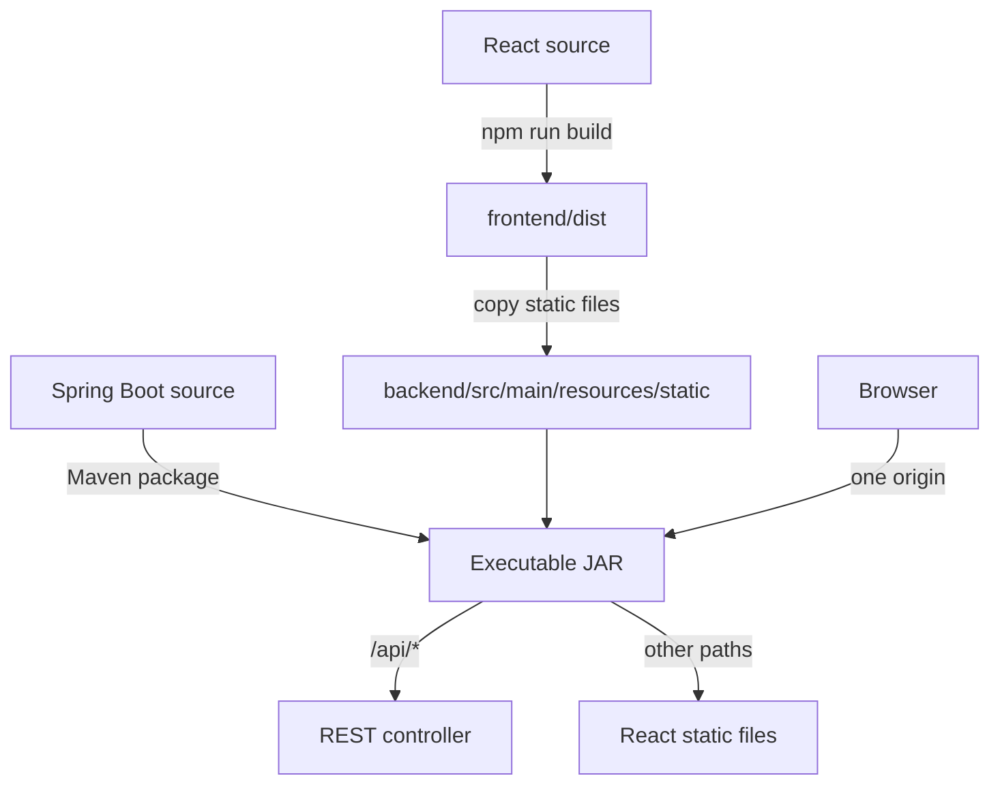

# Build a Full-Stack Employee Directory with Spring Boot and React

This guide modernizes the original tutorial around **Java 21**, **Spring Boot 4.1**, **Maven**, an executable **JAR**, and **React function components with Hooks**. It explains how the browser UI talks to a Spring Boot API, how development differs from production, and how both parts can be delivered together.

> **Version note:** Spring Boot 4.1 is the target of this guide. If it is not yet available in Spring Initializr or your organization’s repository, use the newest Spring Boot version offered there and keep Java 21. The core patterns below—Spring MVC, Spring Data JPA, JSON, Vite, and React Hooks—are the same.

## What you will build

An employee directory with a small REST API. The browser requests and displays employee data; Spring Boot validates and stores it in an H2 database. During development, Vite runs the React app separately and forwards `/api` requests to Spring Boot. For deployment, the built React files are placed in Spring Boot’s static resources and served by the same executable JAR.



In production, there is no separate Vite server:



## 1. Prerequisites

Install:

- **JDK 21** (and make sure `java -version` reports 21).
- **Node.js LTS** and npm (check with `node --version` and `npm --version`).
- An editor and a terminal.

Use the Maven Wrapper (`./mvnw` on macOS/Linux, `mvnw.cmd` on Windows) so the project selects its own Maven version. You do not need to install Maven globally.

## 2. Create the Spring Boot backend

Go to [Spring Initializr](https://start.spring.io/) and generate a Maven project with:

- Project: **Maven**
- Language: **Java**
- Spring Boot: **4.1.x**, if available
- Java: **21**
- Packaging: **Jar**
- Dependencies: **Spring Web** (Spring MVC), **Spring Data JPA**, **H2 Database**, and **Validation**

Choose a package name such as `com.example.employees`. Unzip the generated project. The Java backend and React frontend can live in one repository while remaining separate projects:

```text
employee-directory/
├── backend/                 # Spring Boot Maven project
└── frontend/                # React + Vite project
```

You can either generate the backend directly in `backend/` or move the generated project contents there. The generated `pom.xml` and Maven Wrapper belong in `backend/`.

### Backend layout

```text
backend/
├── pom.xml
└── src/main/
    ├── java/com/example/employees/
    │   ├── EmployeeApplication.java
    │   └── employee/
    │       ├── Employee.java
    │       ├── EmployeeRepository.java
    │       ├── EmployeeController.java
    │       └── CreateEmployeeRequest.java
    └── resources/
        └── application.properties
```

Spring Boot starts the application from the class annotated with `@SpringBootApplication`. The Maven Wrapper builds it into an executable JAR.

## 3. Define the backend data and API

### Employee entity

Create `Employee.java`:

```java
package com.example.employees.employee;

import jakarta.persistence.Entity;
import jakarta.persistence.GeneratedValue;
import jakarta.persistence.GenerationType;
import jakarta.persistence.Id;

@Entity
public class Employee {

    @Id
    @GeneratedValue(strategy = GenerationType.IDENTITY)
    private Long id;

    private String firstName;
    private String lastName;
    private String description;

    protected Employee() {
        // Required by JPA.
    }

    public Employee(String firstName, String lastName, String description) {
        this.firstName = firstName;
        this.lastName = lastName;
        this.description = description;
    }

    public Long getId() { return id; }
    public String getFirstName() { return firstName; }
    public String getLastName() { return lastName; }
    public String getDescription() { return description; }
}
```

`@Entity` tells JPA that this class is stored as a database row. The generated `id` is the row’s identity. JPA uses `jakarta.persistence` imports with modern Spring Boot.

### Repository

Create `EmployeeRepository.java`:

```java
package com.example.employees.employee;

import org.springframework.data.jpa.repository.JpaRepository;

public interface EmployeeRepository extends JpaRepository<Employee, Long> {
}
```

Spring Data creates the repository implementation at runtime. `JpaRepository` provides common operations such as `findAll()` and `save()` without requiring you to write SQL for this example.

### Request validation

Create `CreateEmployeeRequest.java`:

```java
package com.example.employees.employee;

import jakarta.validation.constraints.NotBlank;

public record CreateEmployeeRequest(
        @NotBlank String firstName,
        @NotBlank String lastName,
        @NotBlank String description
) {
}
```

A request record is a convenient immutable type for incoming JSON. Keeping the API request shape separate from the JPA entity makes it easier to evolve the API later.

### REST controller

Create `EmployeeController.java`:

```java
package com.example.employees.employee;

import jakarta.validation.Valid;
import org.springframework.http.HttpStatus;
import org.springframework.web.bind.annotation.GetMapping;
import org.springframework.web.bind.annotation.PostMapping;
import org.springframework.web.bind.annotation.RequestBody;
import org.springframework.web.bind.annotation.RequestMapping;
import org.springframework.web.bind.annotation.ResponseStatus;
import org.springframework.web.bind.annotation.RestController;

import java.util.List;

@RestController
@RequestMapping("/api/employees")
public class EmployeeController {

    private final EmployeeRepository employees;

    public EmployeeController(EmployeeRepository employees) {
        this.employees = employees;
    }

    @GetMapping
    public List<Employee> findAll() {
        return employees.findAll();
    }

    @PostMapping
    @ResponseStatus(HttpStatus.CREATED)
    public Employee create(@Valid @RequestBody CreateEmployeeRequest request) {
        var employee = new Employee(
                request.firstName(),
                request.lastName(),
                request.description()
        );
        return employees.save(employee);
    }
}
```

`@RestController` makes return values JSON responses. `@RequestMapping` sets the common URL prefix. The two routes are:

| Method | URL | Purpose |
| --- | --- | --- |
| `GET` | `/api/employees` | Return all employees as a JSON array |
| `POST` | `/api/employees` | Validate and create an employee from JSON |

A browser does not call the repository or database directly. It sends HTTP requests to these API routes; Spring handles the request, calls the repository, and returns JSON.

### Configure the application and sample data

Set up an in-memory H2 database in `application.properties`:

```properties
spring.application.name=employee-directory
spring.datasource.url=jdbc:h2:mem:employees
spring.datasource.username=sa
spring.datasource.password=
spring.jpa.hibernate.ddl-auto=update
spring.h2.console.enabled=true
```

An in-memory database is convenient for learning, but it resets when the application stops. Do not use this configuration as a production database setup. For a durable app, configure a production database and manage schema changes deliberately.

To preload sample data, add a `CommandLineRunner` bean (for example, in `EmployeeApplication`) and save a few employees through `EmployeeRepository`. Avoid adding the same seed data on every restart to a persistent database unless you intentionally make the operation idempotent.

Start the backend from `backend/`:

```bash
./mvnw spring-boot:run
```

On Windows:

```powershell
mvnw.cmd spring-boot:run
```

Check the endpoint at <http://localhost:8080/api/employees>. With no sample rows, it should return `[]`.

## 4. Create the React frontend

From the repository root, create a React app with Vite:

```bash
npm create vite@latest frontend -- --template react
cd frontend
npm install
```

Vite’s React template uses JavaScript and JSX. TypeScript is also a good option, but JavaScript keeps this first example focused on how the two applications connect.

The frontend structure will look like:

```text
frontend/
├── package.json
├── vite.config.js
└── src/
    ├── App.jsx
    └── main.jsx
```

### Proxy API calls during local development

The development browser page is served by Vite on port `5173`, while Spring Boot listens on port `8080`. Configure Vite to forward `/api` to the backend in `vite.config.js`:

```javascript
import { defineConfig } from 'vite'
import react from '@vitejs/plugin-react'

export default defineConfig({
  plugins: [react()],
  server: {
    proxy: {
      '/api': 'http://localhost:8080',
    },
  },
})
```

Now the React code can request `/api/employees` as a relative URL. The browser talks to Vite, and Vite forwards the API request to Spring Boot. This avoids configuring permissive cross-origin access for local development.

### Fetch data with `useEffect` and `useState`

Replace `src/App.jsx` with:

```jsx
import { useEffect, useState } from 'react'

export default function App() {
  const [employees, setEmployees] = useState([])
  const [loading, setLoading] = useState(true)
  const [error, setError] = useState('')

  useEffect(() => {
    const controller = new AbortController()

    async function loadEmployees() {
      try {
        const response = await fetch('/api/employees', {
          signal: controller.signal,
          headers: { Accept: 'application/json' },
        })

        if (!response.ok) {
          throw new Error(`Request failed (${response.status})`)
        }

        const data = await response.json()
        setEmployees(data)
      } catch (err) {
        if (err.name !== 'AbortError') {
          setError(err.message || 'Could not load employees.')
        }
      } finally {
        if (!controller.signal.aborted) {
          setLoading(false)
        }
      }
    }

    loadEmployees()
    return () => controller.abort()
  }, [])

  if (loading) return <p>Loading employees…</p>
  if (error) return <p role="alert">Error: {error}</p>

  return (
    <main>
      <h1>Employee Directory</h1>
      {employees.length === 0 ? (
        <p>No employees yet.</p>
      ) : (
        <ul>
          {employees.map((employee) => (
            <li key={employee.id}>
              <strong>{employee.firstName} {employee.lastName}</strong>
              {' — '}{employee.description}
            </li>
          ))}
        </ul>
      )}
    </main>
  )
}
```

`useState` stores values that affect the UI. When `setEmployees`, `setLoading`, or `setError` runs, React renders the component again with the new state. `useEffect` runs the data-loading side effect after the component renders. Its empty dependency array means this effect runs when the component mounts. The `AbortController` cancels an outstanding request if the component is removed.

The `key` on each list item helps React track which employee changed. Use a stable identifier from the server (`id` here), not the array index.

Start Vite in another terminal, from `frontend/`:

```bash
npm run dev
```

Open the URL Vite prints, usually <http://localhost:5173>. Keep the Spring Boot process running: the frontend needs it to answer `/api` requests.

### Add a create form

Add this form inside the `main` element in `App.jsx` to create employees. Add the state and handler inside `App`, before the loading/error returns:

```jsx
const [form, setForm] = useState({ firstName: '', lastName: '', description: '' })
const [saving, setSaving] = useState(false)
const [formError, setFormError] = useState('')

async function handleSubmit(event) {
  event.preventDefault()
  setSaving(true)
  setFormError('')

  try {
    const response = await fetch('/api/employees', {
      method: 'POST',
      headers: { 'Content-Type': 'application/json', Accept: 'application/json' },
      body: JSON.stringify(form),
    })

    if (!response.ok) {
      throw new Error(`Could not save employee (${response.status})`)
    }

    const createdEmployee = await response.json()
    setEmployees((current) => [...current, createdEmployee])
    setForm({ firstName: '', lastName: '', description: '' })
  } catch (err) {
    setFormError(err.message || 'Could not save employee.')
  } finally {
    setSaving(false)
  }
}
```

Then render a form, for example below the heading:

```jsx
<form onSubmit={handleSubmit}>
  <label>
    First name
    <input
      required
      value={form.firstName}
      onChange={(event) => setForm({ ...form, firstName: event.target.value })}
    />
  </label>
  <label>
    Last name
    <input
      required
      value={form.lastName}
      onChange={(event) => setForm({ ...form, lastName: event.target.value })}
    />
  </label>
  <label>
    Description
    <input
      required
      value={form.description}
      onChange={(event) => setForm({ ...form, description: event.target.value })}
    />
  </label>
  <button disabled={saving}>{saving ? 'Saving…' : 'Add employee'}</button>
  {formError && <p role="alert">{formError}</p>}
</form>
```

The browser-side `required` attributes improve the form experience; backend validation remains important because clients can bypass browser checks. The React handler sends JSON, Spring validates the request and persists it, and the response contains the newly created employee.

## 5. Follow one request end to end

When the page loads, the request flow is:



For form submission, the browser sends `POST /api/employees` with a JSON body. Spring deserializes it into `CreateEmployeeRequest`, validates it, saves an `Employee`, and responds with status `201 Created` and the saved record as JSON.

## 6. Package frontend and backend into one executable JAR

During development, keep Vite and Spring Boot as separate processes. For a simple single-JAR deployment, build the React app and place its static output under Spring Boot’s static-resource directory:

1. From `frontend/`, run `npm run build`. Vite writes the production site to `frontend/dist/` by default.
2. Copy the contents of `frontend/dist/` into `backend/src/main/resources/static/` (create `static/` if needed). The directory should contain `index.html` and Vite’s generated assets.
3. From `backend/`, run `./mvnw clean package`.
4. Run the resulting JAR: `java -jar target/<generated-name>.jar`.
5. Open <http://localhost:8080>. The same Spring Boot process serves the UI and the `/api/employees` endpoint.



This manual copy is easy to understand, but it can be forgotten. For a repeatable release build, automate frontend installation/build and copying as part of Maven (or use a CI pipeline that builds the frontend before packaging the backend). Make sure the frontend build uses relative API URLs such as `/api/employees`; do not bake `localhost:8080` into the production client.

When UI and API share an origin in production, there is no browser cross-origin request: the page and API have the same scheme, host, and port. If you deploy them separately instead, configure the production web server/API URL and restrict CORS to the actual frontend origin. CORS is a browser security policy, not an authentication mechanism.

## 7. Common issues and how to diagnose them

- **The page loads but the list request fails:** confirm Spring Boot is running on port `8080`, visit `http://localhost:8080/api/employees`, and check the browser’s Network tab for the request URL and status.
- **`404` for `/api/employees`:** check the controller’s `@RequestMapping` and `@GetMapping` path, and ensure the backend package scan includes the controller package.
- **Vite reports a proxy/network error:** check the Vite proxy target and restart Vite after editing `vite.config.js`.
- **Browser reports a CORS error in development:** use the Vite `/api` proxy shown above and call a relative URL. If the frontend is intentionally hosted on a different origin, configure CORS narrowly on the backend.
- **`400` on form submission:** check the JSON field names, `Content-Type: application/json`, and server validation errors. The request names must match `firstName`, `lastName`, and `description`.
- **`500` or database errors:** read the Spring Boot terminal output. Check that the H2 dependency was included and the datasource configuration is valid.
- **The UI is missing from the JAR:** check that `index.html` ended up in `backend/src/main/resources/static/` before Maven packaging, then rebuild the JAR.
- **Old frontend code appears:** rebuild the frontend and JAR, and hard-refresh the browser to bypass cached assets.

Use the browser developer tools’ **Network** and **Console** tabs alongside the Spring Boot logs. They show different sides of the same request.

## 8. What to learn next

This starter app deliberately keeps the scope small. For a real application, learn about:

- DTOs for both request and response data, and consistent API error responses.
- Pagination and sorting instead of returning an unbounded collection.
- Database migrations (such as Flyway) instead of relying on automatic schema updates.
- Authentication, authorization, HTTPS, and secrets management.
- Automated tests: Spring MVC/API tests and React component tests.
- Production database configuration, logging, observability, and deployment.
- A repeatable Maven/CI build that compiles the frontend and packages it into the JAR.

The core connection to remember is simple: **React calls a URL using HTTP; Spring Boot maps that URL to a controller; the controller works with application data and returns JSON; React turns that JSON into UI.**
